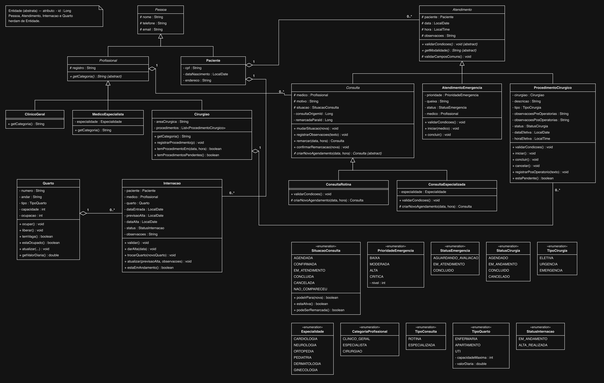

# SistemaHospitalar

Sistema de Informação Hospitalar — trabalho de Programação Modular, PUC Minas, 2026.

O projeto tem duas partes:

| Pasta | Conteúdo | Sprint |
| --- | --- | --- |
| [`frontend/`](frontend/README.md) | Interface em React com todas as telas e dados fictícios | Sprint 1 |
| [`backend/`](backend/) | API REST em Spring Boot com as classes de domínio e as regras de negócio | Sprint 2 |

## Sprint 1 — Frontend em React

O frontend contempla apenas a interface visual, sem integração com o backend.

```bash
cd frontend
npm install
npm run dev
```

Consulte a [documentação do frontend](frontend/README.md) para ver a estrutura, as telas, os limites do protótipo e os comandos de build.

## Sprint 2 — API e modelo de domínio

### Executar

Requisitos: Java 17 ou superior e Maven.

```bash
cd backend
mvn spring-boot:run
```

A API sobe em `http://localhost:8080`. Os dados ficam em memória e são apagados quando a aplicação é reiniciada.

Para rodar os testes:

```bash
cd backend
mvn test
```

### Organização do backend

```text
backend/src/main/java/br/com/hospital/
├── model/        # Classes de domínio e regras de negócio
├── enums/        # Situações, status, prioridades e tipos
├── service/      # Casos de uso: busca, validação entre entidades e persistência
├── controller/   # Endpoints REST
├── dto/          # Corpos das requisições
├── repository/   # Repositórios em memória
└── exception/    # Erros de negócio e tratamento das respostas
```

As regras ficam nas próprias classes de domínio (`Consulta`, `Quarto`, `Internacao`, `ProcedimentoCirurgico`…). Os services buscam os objetos, chamam essas regras e verificam o que depende de mais de uma entidade, como conflitos de horário.

### Modelo de domínio

**Categorias de profissionais.** `Profissional` é abstrata e guarda os dados comuns (nome, registro, telefone e e-mail). Cada categoria é uma subclasse:

- `ClinicoGeral` — realiza consultas de rotina e pode encaminhar o paciente para um especialista;
- `MedicoEspecialista` — possui uma `Especialidade` e só atende consultas dessa área;
- `Cirurgiao` — possui área de atuação cirúrgica e a lista dos procedimentos que realizou ou vai realizar.

**Modalidades de atendimento.** `Atendimento` é abstrata, guarda paciente, data, horário e observações, e obriga cada modalidade a implementar `validarCondicoes()`:

| Modalidade | Regras validadas |
| --- | --- |
| `ConsultaRotina` | médico precisa ser clínico geral; motivo obrigatório; não pode ser no passado |
| `ConsultaEspecializada` | médico precisa ser especialista da mesma especialidade da consulta |
| `AtendimentoEmergencia` | prioridade (`BAIXA`, `MODERADA`, `ALTA`, `CRITICA`) e queixa obrigatórias; status aguardando avaliação → em atendimento → concluído |
| `ProcedimentoCirurgico` | exige cirurgião, descrição e tipo; registra data e hora previstas e efetivas; não pode ser concluído sem ter sido iniciado |

**Situação das consultas.** `SituacaoConsulta` é um enum, então não existe texto livre. Cada situação conhece as transições permitidas:

```text
AGENDADA ──► CONFIRMADA ──► EM_ATENDIMENTO ──► CONCLUIDA
    │             │                │
    └─────────────┴────────────────┴──► CANCELADA
    └─────────────┴──► NAO_COMPARECEU
```

`CONCLUIDA`, `CANCELADA` e `NAO_COMPARECEU` são situações finais. Uma consulta cancelada só volta a acontecer por meio de um novo agendamento (`/remarcar`), que cria outra consulta ligada à original.

**Quartos e internações.** `TipoQuarto` define a capacidade máxima e o valor da diária de cada tipo (`ENFERMARIA` até 4 leitos, `APARTAMENTO` e `UTI` com 1). O quarto não aceita mais pacientes do que a capacidade, e a capacidade nunca fica menor que a ocupação atual. A internação ocupa o quarto, pode trocar de quarto e libera o leito na alta. Um paciente não pode ter duas internações em andamento.

### Endpoints

As respostas de erro seguem o formato `{"timestamp", "status", "erro"}`: `400` para dados inválidos, `404` para registro inexistente e `422` para violação de regra de negócio.

**`/pacientes`**

| Método | Rota | Descrição |
| --- | --- | --- |
| GET | `/pacientes` | Lista os pacientes |
| GET | `/pacientes/{id}` | Busca um paciente |
| POST | `/pacientes` | Cadastra (CPF único) |
| PUT | `/pacientes/{id}` | Atualiza os dados (o CPF não muda) |
| DELETE | `/pacientes/{id}` | Remove, somente se não houver histórico de atendimentos |

**`/profissionais`**

| Método | Rota | Descrição |
| --- | --- | --- |
| GET | `/profissionais?especialidade=` | Lista, opcionalmente por área de atuação |
| GET | `/profissionais/disponiveis?especialidade=&categoria=&data=&hora=` | Profissionais livres no dia e horário |
| GET | `/profissionais/{id}` | Busca um profissional |
| GET | `/profissionais/{id}/procedimentos` | Procedimentos de um cirurgião |
| POST | `/profissionais` | Cadastra conforme a `categoria` |
| PUT | `/profissionais/{id}` | Atualiza (a categoria não muda) |
| DELETE | `/profissionais/{id}` | Remove, se não houver atendimentos ativos |

**`/consultas`**

| Método | Rota | Descrição |
| --- | --- | --- |
| GET | `/consultas?situacao=` | Lista, opcionalmente por situação |
| GET | `/consultas/{id}` | Busca uma consulta |
| POST | `/consultas` | Agenda uma consulta `ROTINA` ou `ESPECIALIZADA` |
| PUT | `/consultas/{id}/situacao` | Muda a situação, respeitando as transições |
| PUT | `/consultas/{id}/observacoes` | Registra observações durante ou após o atendimento |
| POST | `/consultas/{id}/remarcar` | Cria um novo agendamento a partir da consulta |
| POST | `/consultas/{id}/encaminhamento` | Clínico geral encaminha para um especialista |

**`/internacoes`**

| Método | Rota | Descrição |
| --- | --- | --- |
| GET | `/internacoes?status=` | Lista, opcionalmente por status |
| GET | `/internacoes/{id}` | Busca uma internação |
| POST | `/internacoes` | Interna o paciente e ocupa o quarto |
| PUT | `/internacoes/{id}` | Altera previsão de alta e observações |
| PUT | `/internacoes/{id}/trocar-quarto` | Muda o paciente de quarto |
| PUT | `/internacoes/{id}/alta` | Registra a alta e libera o quarto |

**`/quartos`**

| Método | Rota | Descrição |
| --- | --- | --- |
| GET | `/quartos?disponiveis=true` | Lista, opcionalmente só os que têm vaga |
| GET | `/quartos/{id}` | Busca um quarto |
| POST | `/quartos` | Cadastra (número único, capacidade conforme o tipo) |
| PUT | `/quartos/{id}` | Atualiza (capacidade nunca menor que a ocupação) |
| DELETE | `/quartos/{id}` | Remove, se não houver pacientes internados |

**`/emergencias` e `/cirurgias`**

| Método | Rota | Descrição |
| --- | --- | --- |
| GET | `/emergencias?status=` | Fila ordenada por prioridade e chegada |
| POST | `/emergencias` | Registra um atendimento de emergência |
| PUT | `/emergencias/{id}/iniciar` | Inicia com o médico responsável |
| PUT | `/emergencias/{id}/concluir` | Conclui o atendimento |
| GET | `/cirurgias?status=` | Lista os procedimentos |
| POST | `/cirurgias` | Agenda um procedimento |
| PUT | `/cirurgias/{id}/iniciar` | Inicia e registra data e hora efetivas |
| PUT | `/cirurgias/{id}/concluir` | Conclui (somente se iniciado) |
| PUT | `/cirurgias/{id}/cancelar` | Cancela (somente se agendado) |
| PUT | `/cirurgias/{id}/pos-operatorio` | Registra observações pós-operatórias |

### Exemplos de requisição

Cadastrar um especialista:

```http
POST /profissionais
Content-Type: application/json

{
  "nome": "Dra. Helena Martins",
  "registro": "CRM-MG 000001",
  "telefone": "(31) 90000-0011",
  "email": "helena@example.com",
  "categoria": "ESPECIALISTA",
  "especialidade": "CARDIOLOGIA"
}
```

Agendar uma consulta especializada:

```http
POST /consultas
Content-Type: application/json

{
  "tipo": "ESPECIALIZADA",
  "pacienteId": 1,
  "medicoId": 1,
  "data": "2026-12-10",
  "hora": "09:00",
  "motivo": "Avaliação cardiológica",
  "especialidade": "CARDIOLOGIA"
}
```

Remarcar uma consulta:

```http
POST /consultas/1/remarcar
Content-Type: application/json

{ "data": "2026-12-15", "hora": "10:30" }
```

## Diagrama UML

### Sprint 2

<a href="docs/diagramas/diagrama-classes-sprint2.png"></a>

Clique na imagem para abrir em tamanho original. Arquivo editável: [`docs/diagramas/diagrama-classes-sprint2.drawio`](docs/diagramas/diagrama-classes-sprint2.drawio)

### Sprint 1


## Cartões CRC

[Cartões CRC-1.pdf](https://github.com/user-attachments/files/33115812/Cartoes.CRC-1.pdf)
